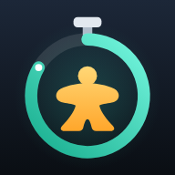

# ボドゲタイマー

クリプティッドのような推理ゲームやパズルゲームで、「考える時間」に制限をかけるためのタイマーです。
iPhone のブラウザ（Safari）で動く Web アプリで、HTML / CSS / JavaScript だけでできています。



---

## iPhone で使う（PC は不要）

アプリは GitHub Pages で公開しています。

**https://syuk650220-creator.github.io/boardgame-timer/**

1. iPhone の Safari で上の URL を開く
2. Safari の **共有ボタン**（□に↑。見当たらないときは「…」の中）→ **「ホーム画面に追加」**
3. 次からはホーム画面のアイコンをタップするだけ。PC も Wi-Fi も必要ありません（一度開けば、電波がなくても動きます）

> URL を知っている人は誰でも開けますが、中身はタイマーだけです。設定はそれぞれの iPhone の中に保存され、外には送られません。

---

## できること

| | |
|---|---|
| 時間の設定 | 1秒〜99分59秒。ドラムロールで自由に設定。よく使う時間はワンタップで呼び出せる（追加・長押しで削除） |
| ボタン1つで操作 | 押すとスタート → 時間内にもう一度押すとリセット → また押すと同じ時間でスタート |
| 時間切れのお知らせ | **音・光・音＋光** から選べる。音は6種類、光（画面全体の点滅）は6色 |
| 知らせる長さ | 3秒 / 5秒 / 10秒 / 止めるまで |
| 残り時間の予告 | 残り3・5・10秒から、1秒ごとに「ピッ」と鳴り画面のふちが赤く光る（オプション） |
| 色で残り時間がわかる | 残り30%で黄色、残りわずかで赤に変わる |
| 時間超過の表示 | 時間切れのあと、何秒オーバーしているかを表示 |
| 設定の保存 | 最後に使った設定は自動で保存。次に開いたときもそのまま使える |

一度「タイマーをセット」したら、**メインメニューに戻るまで同じ制限時間のタイマー**として使い続けます。
時間やお知らせ方法を変えたいときは、左上の「メニュー」から戻ってください（動いている途中なら確認が出ます）。

---

## 知っておいてほしいこと（iPhone の制約）

- **画面の自動ロック**
  iPhone は画面が消えると Web アプリの動作を止めるため、時間切れを知らせられません。
  公開ページ（`https://`）から開けば、タイマー画面の間はアプリが画面をつけたままにします（ホーム画面から開く場合は iOS 18.4 以降）。
  PC から配信した版（`http://`）ではそれができないので、その場合は［設定］→［画面表示と明るさ］→［自動ロック］を「なし」にしてください。
- **マナーモード**
  「マナーモードでも鳴らす」をオンにすると、消音中でも音が出ます（初期設定はオン）。
  音の大きさは iPhone 本体の音量ボタンでも調整してください。
- **音が止まってしまったとき**
  カウントダウン中に他のアプリへ切り替えたり電話が来たりすると、iPhone が音を止めたままにすることがあります。
  そのときはタイマー画面の上に「音が止まっています」と出るので、そこをタップしてください（タイマーはリセットされません）。
  音が鳴らせない状態で時間切れになったときは、「音」だけの設定でも画面の光で知らせます。
- **光について**
  「光」は**画面全体の点滅**です。iPhone のライト（LED）は Web アプリから操作できないため使っていません。
  光過敏に配慮して、点滅は 1 秒に 2 回までにしています。
- **振動について**
  iPhone の Web アプリは、時間切れのタイミングで本体を振動させることができません。
  「ボタンを押したときに振動」は、iOS 18 以降でボタンを押した瞬間だけ軽く振動します。

---

## アプリを直したいとき（PC で編集する）

### 1. 編集して、iPhone で確かめる

1. VS Code でこのフォルダ（`タイマー作成`）を開き、ファイルを編集する
2. **F5** キーを押すと PC からの配信が始まり、QR コードが表示される（PC のブラウザにも大きな QR のページが開きます）
3. iPhone を **PC と同じ Wi-Fi** につなぎ、カメラで QR コードを読み取って確認する

> 止めるときは上部の ■ ボタン（または Shift + F5）。F5 の代わりに Ctrl + Shift + B でも起動できます。

### 2. 公開ページに反映する

1. VS Code の左側にある **ソース管理**（枝分かれのアイコン）を開く
2. 変更内容のメッセージを書いて **「コミット」** → **「変更の同期」**（GitHub に送る）
3. 1〜2 分で公開ページに反映されます。iPhone ではアプリを開き直すと新しい版になります（ネットにつながっているとき）

### PC から配信してもつながらないとき

- **大学・ホテル・カフェなどの Wi-Fi** は、端末どうしの通信が禁止されていることがよくあります。
  → iPhone の **インターネット共有（テザリング）** をオンにして、PC をその Wi-Fi につなぐと確実です。
  サーバーを起動し直すと、新しい QR コード（`http://172.20.10.…`）が表示されます。
- サーバー起動時に **「Windows セキュリティの重要な警告」** が出たら、**「アクセスを許可する」** を押してください。
- QR が読み取りにくいときは、PC のブラウザで `http://localhost:8080/connect` を開くと大きな QR を表示できます。

---

## ファイル構成

```
タイマー作成/
├─ index.html            画面の骨組み（メニュー画面・タイマー画面）
├─ css/style.css         見た目（色は先頭の :root でまとめて変更できます）
├─ js/
│  ├─ app.js             全体の動き（画面の切り替え・ボタン操作）
│  ├─ timer.js           カウントダウンの中身（スタート・リセット・予告・時間切れ）
│  ├─ sound.js           音（Web Audio で合成。音の追加は SOUNDS に1つ書き足すだけ）
│  ├─ picker.js          時間を選ぶドラムロール
│  ├─ device.js          画面のスリープ防止・振動
│  ├─ settings.js        設定の保存と読み込み
│  └─ util.js            共通の小さな関数
├─ manifest.webmanifest  ホーム画面に追加したときの設定
├─ sw.js                 オフライン対応（公開ページで使用）
├─ icons/                アイコン（icon.svg が元データ）
├─ tools/
│  ├─ serve.js           PC から iPhone に配信するサーバー（QR コード表示つき）
│  ├─ qr.js              QR コードを作る処理
│  ├─ test-timer.js      タイマーの自動テスト
│  └─ make-icons.js      icon.svg から PNG アイコンを作り直す
└─ .vscode/              F5 で起動するための VS Code の設定
```

## 開発用コマンド

VS Code のメニュー［ターミナル］→［タスクの実行...］からも実行できます。

| コマンド | 内容 |
|---|---|
| `npm start` | PC から配信して、接続用ページ（QR コード）を開く |
| `npm test` | タイマーの自動テストを実行 |
| `npm run icons` | `icons/icon.svg` から PNG アイコンを作り直す |

## カスタマイズの例

- **色を変える**：`css/style.css` の先頭にある `--accent`（通常時の色）や `--danger`（時間切れの色）
- **音を追加する**：`js/sound.js` の `SOUNDS` に、ほかの音をまねて1つ追加（メニューに自動で並びます）
- **光の色を追加する**：`js/app.js` の `LIGHT_COLORS` に1行追加
- **最初から並んでいるプリセット**：`js/settings.js` の `presets`
